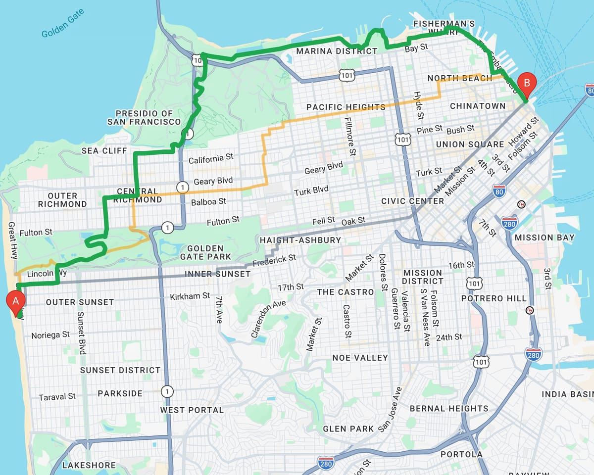
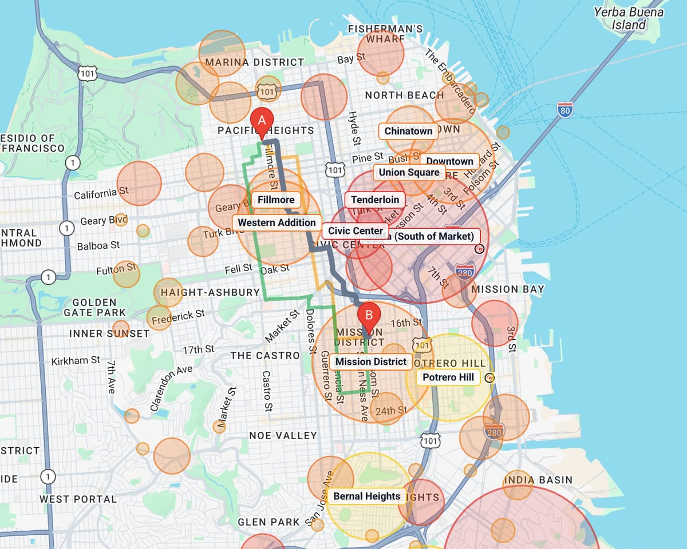
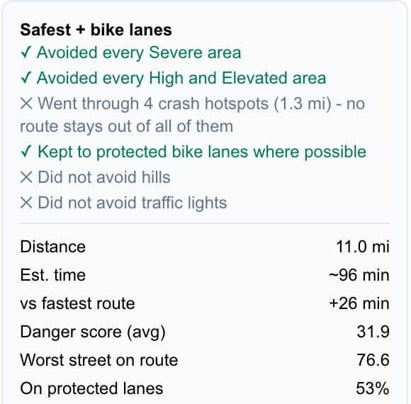
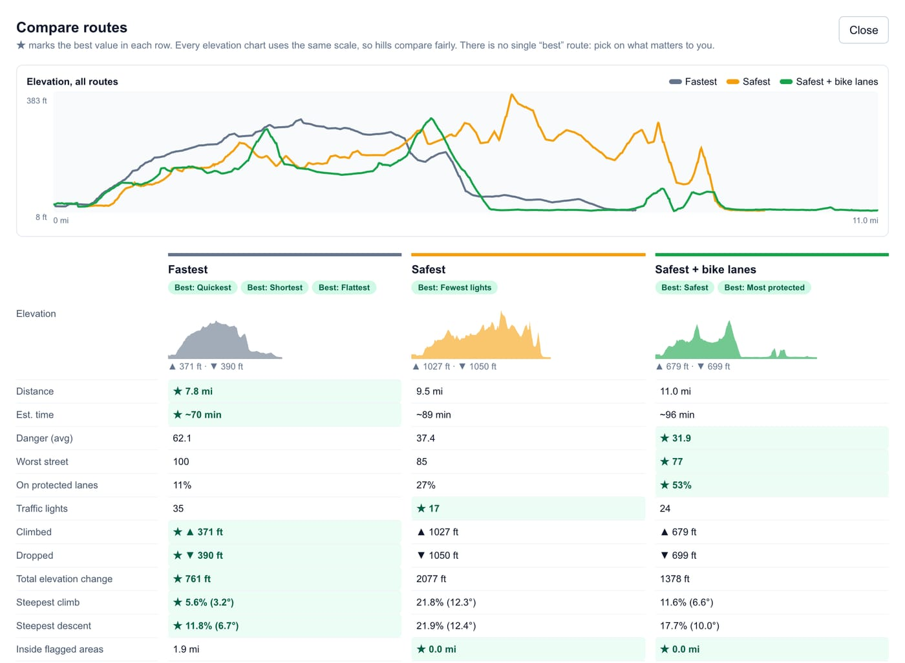
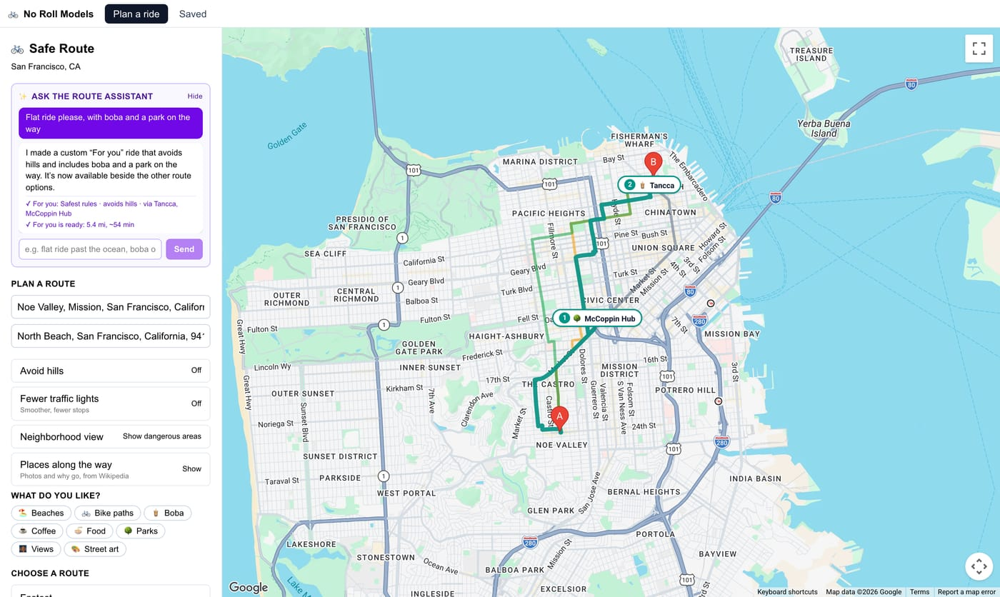
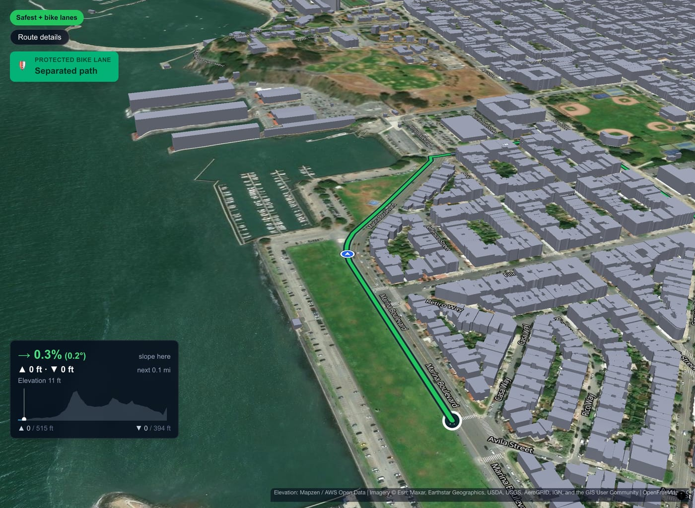
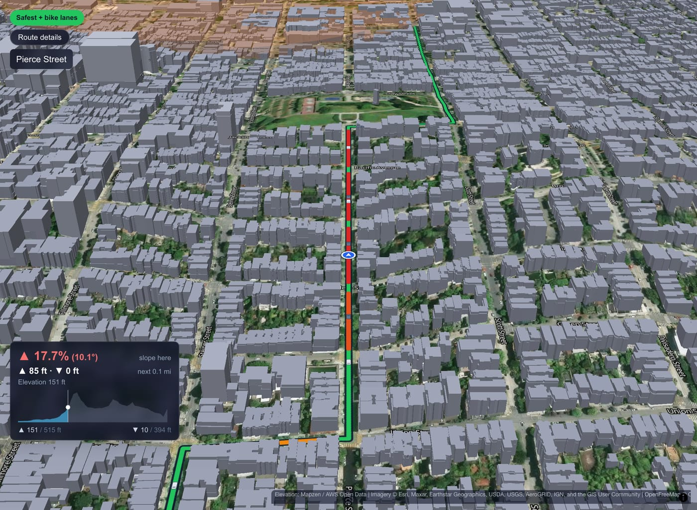
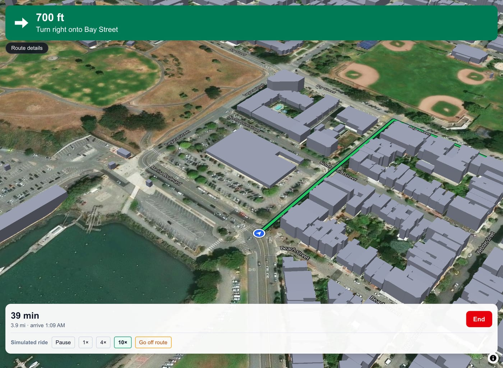

# No Roll Models: the bike map that routes for safety, not just speed

Every map app will tell you the fastest way to bike across San Francisco. No Roll
Models tells you the **safest** way and shows its work. It routes around the city's
real crash hotspots and dangerous corridors, keeps you on protected lanes and
avoids walls of hills. Every route says exactly what it avoided and what that
cost you.



📊 **Demo deck:** [`docs/NoRollModels_Demo_Deck.pptx`](docs/NoRollModels_Demo_Deck.pptx) ([PDF](docs/NoRollModels_Demo_Deck.pdf)). The spoken script is in the speaker notes.

## The problem: bike danger is concentrated

- **1,103** cyclists were killed on US roads in 2024, and **52,887** were injured, up 6% from 2023. 81% of those deaths happened in cities. ([NHTSA, 2024 data](https://rosap.ntl.bts.gov/view/dot/92690))
- In San Francisco, **4% of street miles hold 55% of severe and fatal bike injuries.** ([SFMTA Vision Zero High Injury Network](https://sfmta.com/media/4894/download))

Danger isn't spread evenly. It's concentrated, so it can be routed around.
Fastest-first navigation does the opposite: the fastest route from Pacific
Heights to the Mission spends more than half the ride inside flagged areas.



## Results

We measured 8 cross-town San Francisco trips through the router, comparing
**Fastest** with **Safest + bike lanes** (averaged per trip):

| | Fastest | Safest + bike lanes | Change |
|---|---|---|---|
| Share of the ride inside flagged areas | 30.2% | 11.4% | **−62%** |
| Average street danger (0–100) | 63.2 | 44.3 | **−30%** |
| Share of the ride on protected lanes | 14.2% | 29.6% | **2.1×** |
| Ride time | | | +28%, shown on every route |

Example: **Ocean Beach → Ferry Building**. Average danger drops from 62 to 32,
protected lanes go from 11% to 53% of the ride, and the safe route enters no
flagged area. The cost is 26 more minutes, and the app says so.

## What it does

### Impact: real data and our own router

The app doesn't nudge Google Directions. It runs its own A* router over a
**211,000-segment** San Francisco street graph and plans three routes in about
0.1 s. Every street is scored with real open data:

| Data | Source |
|---|---|
| 3,558 bike-injury crashes, 2019+ | DataSF, Traffic Crashes Resulting in Injury |
| 5,457 surveyed bike-lane segments | SFMTA Bike Network. This is authoritative over OpenStreetMap and corrected 32,000 lane ratings. |
| 5,566 highways and fast arterials | OpenStreetMap |
| 1,314 traffic signals that stop a rider | SFMTA signal inventory |
| Elevation at every intersection | USGS terrain (AWS Terrain Tiles) |
| 177,023 LiDAR-measured buildings (3D tour) | DataSF building footprints |

You get three options for every trip: **Fastest**, **Safest** and **Safest + bike lanes**.

### Practical: honest trade-offs a rider can trust

- **Rules you can read.** The safer routes never enter a Severe area. They also
  avoid High and Elevated areas unless that makes the ride more than 40% longer,
  and when they do go through, they say where and why.
- **No fake safety claims.** A route only says it "avoided" an area if the
  fastest route actually goes through it.
- **Avoid hills** uses real terrain grades. On Ocean Beach → Ferry Building it
  cuts the steepest climb from 21.8% to 8.6% and total climbing from 1,027 ft to
  518 ft, and the ride is 7 minutes quicker. **Fewer traffic lights** is there
  for comfort and never overrides safety.
- **Compare side by side**: every stat, elevation on one shared scale, and the
  best value in each row starred.
- **Turn-by-turn navigation** with live GPS in a phone browser. Rerouting keeps
  your safety choice.
- **Edit and save routes**: add or drag stops, take suggested edits ("Save 8 min
  via Steiner St; costs +46 ft climbing"), save rides and add photos from the stops.

<p>
  
  
</p>

### Creative: talk to your route, then preview it

- **Route assistant.** Type "flat ride please, with boba and a park on the way"
  and you get a "For you" ride with those stops pinned. The AI never draws a
  route itself: it can only use the same controls a rider uses, so it can't
  break a safety rule, and every change shows up in the sidebar where you can
  undo it.
- **Rides by interest.** Pick beaches, boba, coffee, food, parks, views, street
  art or bike paths from 3,712 real places. A place inside a Severe area is
  never chosen.
- **Places along the way**: photo pins from Wikipedia, each with a short "why go".
- **3D preview tour** on real aerial imagery, real terrain and the city's LiDAR
  building heights. It calls out protected lanes as you reach them and shows the
  slope ahead.



<p>
  
  
</p>



## Built like a product

- **411 automated tests** (Vitest). Many are checked by breaking the code on
  purpose and confirming the test fails.
- Every safety claim the UI makes is checked across many landmark trips in
  `lib/routing/*.test.ts`.
- An ML training pipeline (`ml/`) trains and serves on exactly the same street
  features. See [`ml/README.md`](ml/README.md).
- [`ARCHITECTURE.md`](ARCHITECTURE.md) has the full build log.

## Getting started

### 1. Install dependencies

```bash
npm install
```

### 2. Set up your keys

```bash
cp .env.local.example .env.local
```

- `NEXT_PUBLIC_GOOGLE_MAPS_API_KEY`: a key with the **Maps JavaScript API**
  enabled, from the [Google Cloud Console](https://console.cloud.google.com/google/maps-apis).
  Address search uses OpenStreetMap, and routing is our own, so no other Google
  APIs are needed.
- `OPENAI_API_KEY`: for the route assistant. It stays on the server and never
  reaches the browser. Without it, everything else works and the assistant tells
  you what to add.

### 3. Run it

```bash
npm run dev
```

Open [http://localhost:3000](http://localhost:3000). The first route after
starting takes a few seconds while the routing engine loads. After that, routes
take about 0.1 s.

### Tests

```bash
npm test          # Vitest
npx tsc --noEmit  # type check
npm run lint
```

### Testing navigation

After choosing a route, press **Confirm route**, then **Start navigation** for
live GPS from the browser.

For desktop testing, open the app with `?testmode`
(`http://localhost:3000/?testmode`). This adds **Simulate ride**: a synthetic
rider follows the route through the same matching, instruction and rerouting
code as real GPS. Use 1× / 4× / 10× to change speed, and **Go off route** to
check rerouting.

### Testing GPS on a phone

Browsers only share location with a **secure** page: `https://...`, or
`http://localhost` on the same machine. Opening `http://192.168.x.x:3000` on a
phone is *not* secure, and the browser refuses location without even asking.
So give the dev server an https URL:

**Option A: tunnel (recommended; works on iPhone and Android, no warnings)**

```bash
npm run dev                                      # terminal 1
brew install cloudflared                         # once
cloudflared tunnel --url http://localhost:3000   # terminal 2
```

Open the `https://<random>.trycloudflare.com` URL it prints on your phone and
allow location when asked. (`ngrok http 3000` works the same way.) Both domains
are already allowed in `next.config.ts`. If your Google Maps key restricts HTTP
referrers, add `*.trycloudflare.com/*` to the key in Google Cloud Console, or
the base map will not load on the tunnel URL.

**Option B: self-signed https on your network**

```bash
npm run dev:https
```

Then open `https://<your-mac-ip>:3000` on the phone and accept the certificate
warning. Android Chrome then allows location; iOS Safari is less reliable with
self-signed certificates, so prefer Option A there.

On the phone, keep the screen on and the page in front while riding. A web page
cannot get location in the background; that needs a native app.

## Honest limits, and what's next

- **Area risk levels are hand-set today.** The 17 flagged neighbourhoods use
  three risk bands (Severe, High, Elevated) that we set by hand. Next: learn them
  from crash *rates* (adjusted for how many people ride each street) rather than
  raw counts, so a busy protected lane isn't punished for being popular.
- **Near-miss reports.** Add rider reports from BikeMaps.org alongside crashes.
- **More cities.** Everything runs on open city data, so any city with open
  crash and bike-lane data can be added, starting with Vision Zero cities.
- **Native app** for background GPS and alerts as you approach a danger spot.
- The cars in the 3D tour are illustrative (density by road class, not live
  traffic), and the app says so on screen.

## Credits

Map data © OpenStreetMap contributors (ODbL). Crash, bike-network, signal and
building data from DataSF and SFMTA. Terrain from AWS Terrain Tiles (USGS).
Aerial imagery © Esri and its partners. Place photos from Wikipedia and
Wikimedia Commons, credited in the app.
